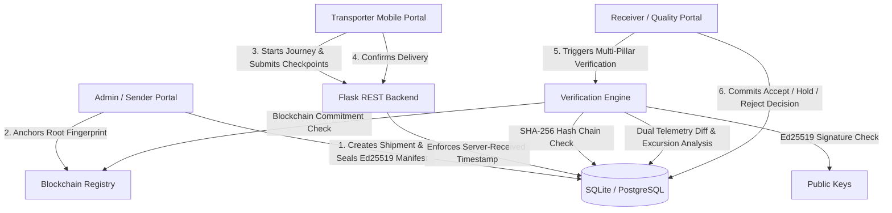

# ColdChain Ledger — PS08: Tamper-Evident Transport Log

> **A verifiable, tamper-evident custody and temperature audit system for high-value pharmaceutical cold chain shipments.**

---

## 🚀 Overview

In temperature-sensitive pharmaceutical distribution (vaccines, insulin, biologics), relying solely on transporter-reported temperatures creates a single point of failure where logs can be retroactively fabricated or altered.

**ColdChain Ledger** solves this with a **Dual-Dataset Verification Engine**:
1. **Independent Sealed IoT Telemetry**: Authoritative sensor records chained via canonical **SHA-256 hash chains** and sealed with an **Ed25519 digital signature manifest**.
2. **Transporter Checkpoints**: Driver checkpoints captured in real-time with **server-enforced non-repudiation timestamps**.
3. **Automated Cross-Verification**: Side-by-side reconciliation, excursion detection, sequence anomaly analysis, and on-chain fingerprint anchoring.

---

## 🏛️ System Architecture



---

## 🔐 Cryptographic Pillars

| Pillar | Implementation | Guarantee |
|---|---|---|
| **Hash Chaining** | Canonical JSON with sorted keys + SHA-256 (`previous_hash` linking) | Any alteration of intermediate temperature or timestamp breaks the entire chain. |
| **Digital Signatures** | Asymmetric Ed25519 (`cryptography.hazmat`) | Proof of origin; prevents unauthorized sensor data substitution. |
| **Blockchain Anchoring** | `ColdChainRegistry.sol` (EVM compatible) | Immutable timestamping of root dataset fingerprint. |
| **Server Timestamps** | UTC timestamp recorded at arrival on server | Prevents driver backdating or batch-retrofitting logs. |

---

## 👤 Portals & Demo Accounts

| Role | Username | Password | Portals & Capabilities |
|---|---|---|---|
| **Admin / Sender** | `admin` | `Admin@1234` | Create shipments, configure 2–8°C thresholds, assign drivers, initialize sensor baselines. |
| **Transporter / Driver** | `transporter1` | `Transport@1234` | Mobile interface: start journey, log checkpoints, receive excursion warnings, confirm delivery. |
| **Receiver / Inspector** | `receiver` | `Receiver@1234` | Automated verification engine, dual-dataset comparison, regulatory accept/reject decisions. |

---

## 📦 Deterministic Demo Shipments

- **`SHIP-1001` (Clean Shipment)**: 100% matched driver and IoT readings; no excursions; status `DELIVERED` → verifies clean (`VERIFIED`, `COMPLIANT`).
- **`SHIP-1002` (Tampering Detected)**: Driver falsified logs (logged 5.7°C, 5.3°C) while sealed sensor recorded true heat excursions (8.7°C, 9.1°C). Verification engine immediately detects and flags mismatch.
- **`SHIP-1003` (Sequence & Excursion Anomaly)**: Missing sensor sequence 4, duplicate driver timestamp, and excursion at sequence 3.

---

## 🛠️ How to Run

### Backend (Flask + SQLite)
```bash
cd backend
# Run all 31 backend unit and integration tests
python -m pytest tests/ -v

# Start the Flask API server (port 5000)
python run.py
```

### Frontend (React + Vite)
```bash
cd frontend
# Build production bundle
npm run build

# Or run development server (port 5173)
npm run dev
```

---

## 🧪 Testing Results
- **Backend Tests**: 31 passed (`pytest tests/`)
- **Frontend Build**: 100% passed (`vite build`)
